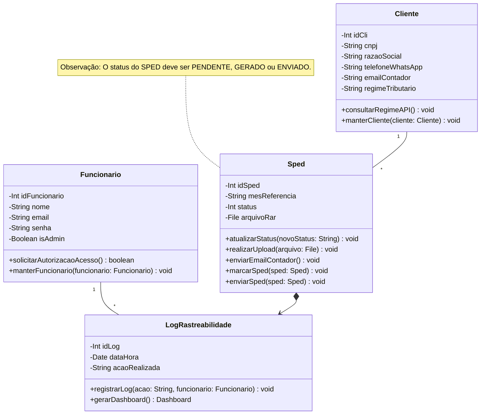
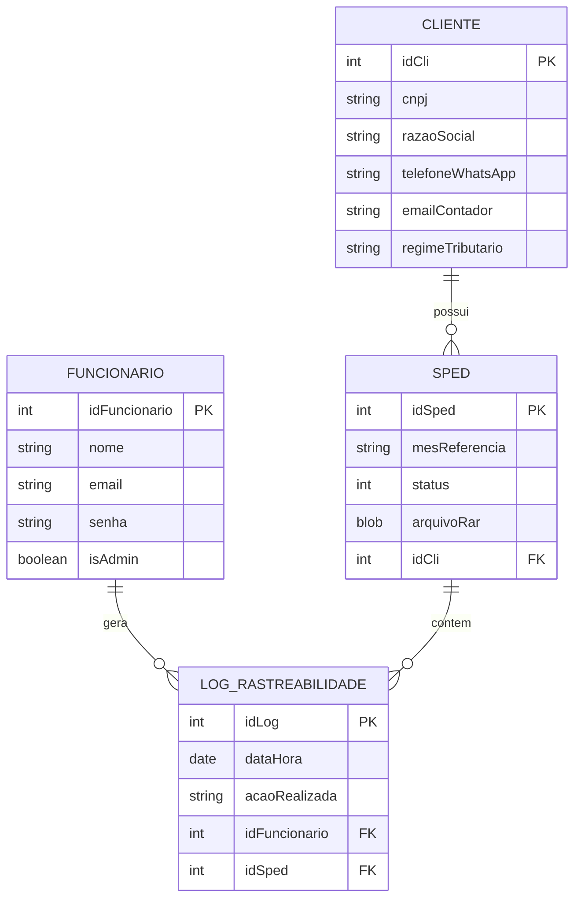

# Documento de Modelos

Neste documento temos o modelo Conceitual (UML) ou de Dados (Entidade-Relacionamento). Temos também a descrição das entidades e o dicionário de dados.

## Modelo Conceitual

### Diagrama de Classes usando Mermaid

### Descrição das Entidades

Descrição sucinta das entidades presentes no sistema.

| Entidade | Descrição |
|----------|----------------------------------------------------------------------------------------------------------------------------------------------------------------------------------------------------------------|
| Funcionario | Entidade que representa um Funcionário tem as informações: Int idFuncionario, String nome, String email, String senha, Boolean isAdmin, +solicitarAutorizacaoAcesso(), +manterFuncionario(). |
| LogRastreabilidade | Entidade que representa o log do sistema tem as informações: Int idLog, Date dataHora, String acaoRealizada, +registrarLog(), +gerarDashboard(). |
| Cliente | Entidade que representa um Cliente tem as informações: Int idCli, String cnpj, String razaoSocial, String telefoneWhatsApp, String emailContador, String regimeTributario, +consultarRegimeAPI(), +manterCliente(). |
| Sped | Entidade que representa um registro SPED tem as informações: Int idSped, String mesReferencia, Int status, File arquivoRar, +atualizarStatus(), +realizarUpload(), +enviarEmailContador(), +marcarSped(), +enviarSped(). |

## Modelo de Dados (Entidade-Relacionamento)

### Dicionário de Dados

|   Tabela   | FUNCIONARIO |
| ---------- | ----------- |
| Descrição  | Armazena as informações dos funcionários que utilizam e administram o sistema. |
| Observação | O campo `isAdmin` define se o funcionário possui privilégios de administrador. |

|  Nome          | Descrição                        | Tipo de Dado | Tamanho | Restrições de Domínio |
| -------------- | -------------------------------- | ------------ | ------- | --------------------- |
| idFuncionario  | identificador gerado pelo SGBD   | SERIAL       | ---     | PK / Identity         |
| nome           | nome completo do funcionário     | VARCHAR      | 150     | Not Null              |
| email          | e-mail de acesso do funcionário  | VARCHAR      | 150     | Unique / Not Null     |
| senha          | senha criptografada de acesso    | VARCHAR      | 255     | Not Null              |
| isAdmin        | flag de privilégio administrador | BOOLEAN      | ---     | Not Null              |

|   Tabela   | LOG_RASTREABILIDADE |
| ---------- | ----------- |
| Descrição  | Armazena o registro (histórico) das ações executadas no sistema. |
| Observação | Usado para auditoria de ações realizadas pelos funcionários, podendo ou não estar atrelado a um SPED. |

|  Nome          | Descrição                        | Tipo de Dado | Tamanho | Restrições de Domínio |
| -------------- | -------------------------------- | ------------ | ------- | --------------------- |
| idLog          | identificador gerado pelo SGBD   | SERIAL       | ---     | PK / Identity         |
| dataHora       | data e hora exata da ação        | TIMESTAMP    | ---     | Not Null              |
| acaoRealizada  | descrição detalhada da ação      | VARCHAR      | 250     | Not Null              |
| idFuncionario  | funcionário responsável pela ação| SERIAL       | ---     | FK / Not Null         |
| idSped         | SPED associado à ação (se houver)| SERIAL       | ---     | FK                    |

|   Tabela   | CLIENTE |
| ---------- | ----------- |
| Descrição  | Armazena os dados das empresas (clientes) vinculadas ao sistema. |
| Observação | Os clientes são as entidades para as quais os arquivos do SPED são gerados. |

|  Nome             | Descrição                        | Tipo de Dado | Tamanho | Restrições de Domínio |
| ----------------- | -------------------------------- | ------------ | ------- | --------------------- |
| idCli             | identificador gerado pelo SGBD   | SERIAL       | ---     | PK / Identity         |
| cnpj              | CNPJ do cliente                  | VARCHAR      | 18      | Unique / Not Null     |
| razaoSocial       | razão social do cliente          | VARCHAR      | 150     | Not Null              |
| telefoneWhatsApp  | número de contato (WhatsApp)     | VARCHAR      | 20      | ---                   |
| emailContador     | e-mail do contador responsável   | VARCHAR      | 150     | Not Null              |
| regimeTributario  | regime tributário do cliente     | VARCHAR      | 50      | Not Null              |

|   Tabela   | SPED |
| ---------- | ----------- |
| Descrição  | Armazena os registros e os arquivos RAR referentes aos SPEDs dos clientes. |
| Observação | O status deve ser controlado pela aplicação, mapeando os inteiros (ex: 1 = PENDENTE, 2 = GERADO, 3 = ENVIADO). |

|  Nome          | Descrição                        | Tipo de Dado | Tamanho | Restrições de Domínio |
| -------------- | -------------------------------- | ------------ | ------- | --------------------- |
| idSped         | identificador gerado pelo SGBD   | SERIAL       | ---     | PK / Identity         |
| mesReferencia  | mês e ano de referência (MM/AAAA)| VARCHAR      | 7       | Not Null              |
| status         | status atual do SPED             | INTEGER      | ---     | Not Null              |
| arquivoRar     | arquivo binário anexado          | BYTEA        | ---     | ---                   |
| idCli          | cliente titular do SPED          | SERIAL       | ---     | FK / Not Null         |