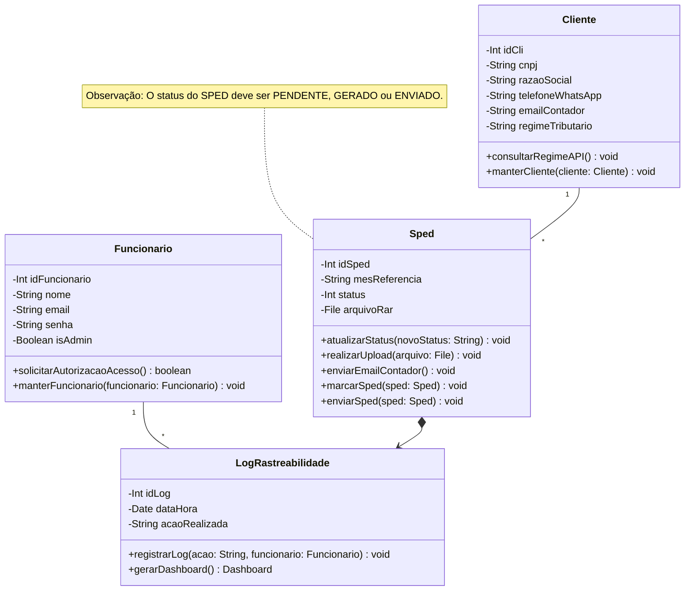
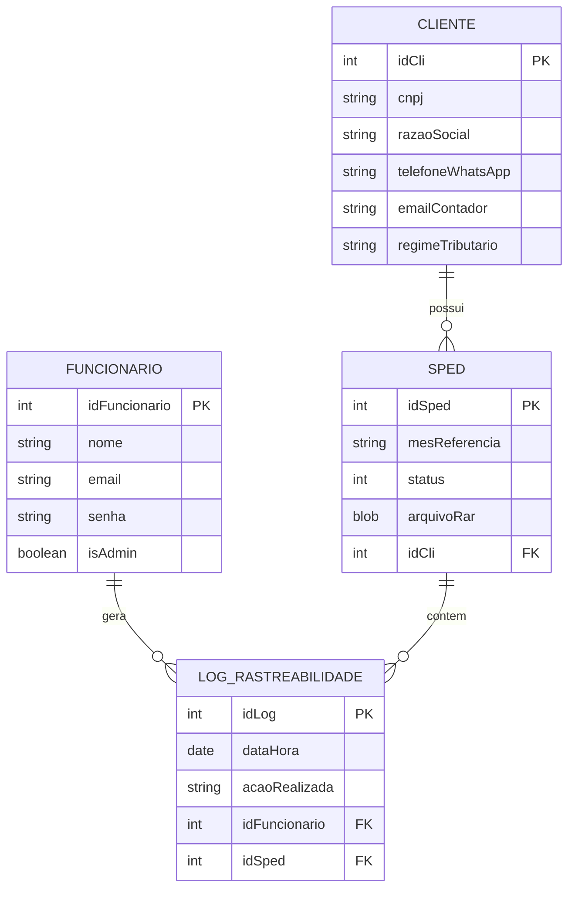

# Documento de Modelos

Neste documento temos o modelo Conceitual (UML) ou de Dados (Entidade-Relacionamento). Temos também a descrição das entidades e o dicionário de dados.

## Modelo Conceitual

### Diagrama de Classes usando Mermaid

### Descrição das Entidades

Descrição sucinta das entidades presentes no sistema.

| Entidade | Descrição |
|----------|----------------------------------------------------------------------------------------------------------------------------------------------------------------------------------------------------------------|
| Funcionario | Entidade que representa um Funcionário tem as informações: Int idFuncionario, String nome, String email, String senha, Boolean isAdmin, +solicitarAutorizacaoAcesso(), +manterFuncionario(). |
| LogRastreabilidade | Entidade que representa o log do sistema tem as informações: Int idLog, Date dataHora, String acaoRealizada, +registrarLog(), +gerarDashboard(). |
| Cliente | Entidade que representa um Cliente tem as informações: Int idCli, String cnpj, String razaoSocial, String telefoneWhatsApp, String emailContador, String regimeTributario, +consultarRegimeAPI(), +manterCliente(). |
| Sped | Entidade que representa um registro SPED tem as informações: Int idSped, String mesReferencia, Int status, File arquivoRar, +atualizarStatus(), +realizarUpload(), +enviarEmailContador(), +marcarSped(), +enviarSped(). |

## Modelo de Dados (Entidade-Relacionamento)

