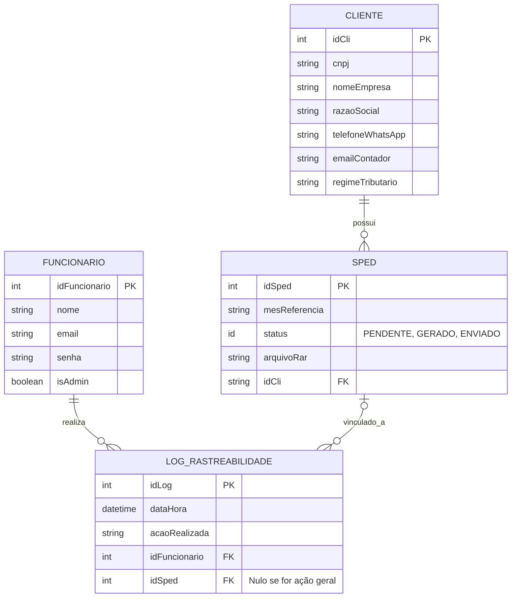

# Documento de Visão

Documento construído a partir do **Modelo BSI - Doc 001 - Documento de Visão** que pode ser encontrado no
link: https://docs.google.com/document/d/1DPBcyGHgflmz5RDsZQ2X8KVBPoEF5PdAz9BBNFyLa6A/edit?usp=sharing

## Descrição do Projeto

O projeto consiste no desenvolvimento de um **sistema de controle de fluxo (workflow)** para automatizar e organizar o processo de geração mensal de SPEDs da empresa **Intech Sistemas**, que atua no ramo de tecnologia da informação, oferecendo soluções em desenvolvimento de sistemas, suporte técnico, automação comercial, integração de serviços fiscais e soluções para gestão empresarial.

### Problema

Atualmente, a Intech Sistemas realiza o controle da geração mensal de SPEDs de forma manual, utilizando planilhas e ferramentas externas de comunicação, o que gera gargalos operacionais, falhas de comunicação entre os funcionários e falta de rastreabilidade das atividades realizadas. Esse processo descentralizado dificulta o acompanhamento da fila de atendimento, aumenta o risco de esquecimentos e atrasos no envio dos arquivos fiscais, podendo causar problemas e multas para os clientes da empresa.

### Solução Proposta

A solução proposta consiste no desenvolvimento de um sistema de controle de fluxo (workflow) para automatizar e organizar o processo de geração mensal de SPEDs da Intech Sistemas, permitindo o gerenciamento centralizado da fila de atendimento com priorização baseada no regime tributário dos clientes. O sistema terá funcionalidades de rastreabilidade, controle de status, registro automático das atividades e acompanhamento gerencial, buscando reduzir falhas operacionais, melhorar a comunicação interna e aumentar a eficiência do processo.

### Escopo

O sistema de controle de fluxo para geração mensal de SPEDs será responsável por centralizar e organizar todo o processo operacional realizado pela Intech Sistemas. Através do sistema será possível realizar o cadastro e gerenciamento de clientes, controle de usuários com diferentes níveis de acesso, consulta automática do regime tributário via API utilizando o CNPJ, definição automática da fila de prioridade para geração dos SPEDs e acompanhamento completo do fluxo de trabalho através de status progressivos. Além disso, o sistema permitirá registrar automaticamente logs de rastreabilidade das atividades realizadas pelos funcionários, armazenando informações de data, hora e usuário responsável por cada alteração no processo. O sistema também contará com dashboards gerenciais para acompanhamento da produtividade mensal da equipe e monitoramento do andamento das demandas fiscais.

## Equipe e Definição de Papéis

A equipe adota o **Scrum** como framework de gerenciamento do trabalho, com os papéis **rotativos entre os membros ao longo das Sprints**. Os papéis do Scrum são:

- **Product Owner (PO / Dono do Produto)**: único responsável por gerenciar o Product Backlog e maximizar o valor do trabalho entregue pela equipe. Define e prioriza as funcionalidades, comunica claramente a visão do produto para a equipe e os stakeholders e decide o que deve ser desenvolvido e em qual ordem.
- **Scrum Master**: atua como um líder servidor e facilitador do Scrum, garantindo que o framework seja compreendido e aplicado corretamente. Remove impedimentos que bloqueiam o progresso do time, auxilia a equipe a se auto-organizar e protege o grupo de interferências externas, atuando como coach sem exercer controle hierárquico tradicional.
- **Desenvolvedores (Developers)**: grupo de profissionais multifuncionais responsável por criar o incremento do produto a cada Sprint. Planejam como realizar o trabalho do Sprint Backlog, criam itens de qualidade, realizam testes e se auto-organizam para cumprir a meta definida.

Membro     |     Papel   |   E-mail   |
---------  | ----------- | ---------- |
Karliane | Cliente (Professora/Orientadora) | karliane.vale@ufrn.br
Eriky | Product Owner, Scrum Master e Developer (rotativo por Sprint) | eriky.medeiros.706@ufrn.edu.br
Felipe | Product Owner, Scrum Master e Developer (rotativo por Sprint) | —
Jefferson | Product Owner, Scrum Master e Developer (rotativo por Sprint) | —
José Samuel | Product Owner, Scrum Master e Developer (rotativo por Sprint) | jose.lima.146@ufrn.edu.br
Renan | Product Owner, Scrum Master e Developer (rotativo por Sprint) | renan.medeiros.150@ufrn.edu.br

### Matriz de Competências

Membro     |     Competências   |
---------  | ----------- |
Eriky | TypeScript, Django (Python), Supabase/PostgreSQL, Git/GitHub, Modelagem UML |
Felipe | TypeScript, Supabase/PostgreSQL, Git/GitHub, Modelagem UML |
Jefferson | Django (Python), Supabase/PostgreSQL, Git/GitHub, Modelagem UML |
José Samuel | TypeScript, Django (Python), Git/GitHub, Metodologias Ágeis (Scrum) |
Renan | TypeScript, Django (Python), Supabase/PostgreSQL, Git/GitHub, Metodologias Ágeis (Scrum) |

## Perfis dos Usuários

O sistema poderá ser utilizado por diversos usuários. Temos os seguintes perfis/atores:

Perfil                                 | Descrição   |
---------                              | ----------- |
Administrador | Este usuário realiza o gerenciamento dos colaboradores e seus níveis de acesso, e pode realizar qualquer função do sistema.
Funcionário (Usuário) | Este usuário, após autenticado, acessa a fila de atendimento, atualiza o status dos SPEDs, envia os arquivos aos contadores e visualiza os dashboards gerenciais.

## Lista de Requisitos Funcionais

### Entidade Usuário - US01 - Manter Usuário
Um usuário representa um colaborador da Intech Sistemas. Ele tem: nome, e-mail, senha e nível de acesso (Funcionário ou Administrador).

Requisito                     | Descrição   | Ator |
---------                     | ----------- | ---------- |
RF01.01 - Inserir Usuário      | Insere novo usuário informando: nome, e-mail, senha e nível de acesso. | Administrador |
RF01.02 - Listar Usuários      | Listagem de usuários utilizando filtros nos atributos: nome e e-mail. | Administrador |
RF01.03 - Atualizar Usuário    | Atualiza um usuário informando: nome, e-mail, senha e nível de acesso. | Administrador |
RF01.04 - Deletar Usuário      | Deleta um usuário informando o e-mail. | Administrador |
RF01.05 - Login do Usuário     | Realiza login informando e-mail e senha; o sistema valida as credenciais em até 5 segundos e libera o acesso conforme o perfil. | Usuário |

---

### Entidade Cliente - US02 - Manter Cliente
Um cliente representa uma empresa atendida pela Intech Sistemas. Ele tem: CNPJ, nome da empresa, razão social, telefone/WhatsApp para contato, e-mail do contador e regime tributário.

Requisito                     | Descrição   | Ator |
---------                     | ----------- | ---------- |
RF02.01 - Inserir Cliente     | Insere novo cliente informando o CNPJ; o sistema consulta automaticamente os dados da empresa e o regime tributário via API, e o usuário informa os demais dados (telefone/WhatsApp e e-mail do contador). | Funcionário |
RF02.02 - Listar Clientes      | Listagem de clientes utilizando filtros nos atributos: CNPJ, nome da empresa, razão social e regime tributário. | Funcionário |
RF02.03 - Atualizar Cliente    | Atualiza um cliente informando: nome, telefone/WhatsApp, e-mail do contador e regime tributário. | Funcionário |
RF02.04 - Deletar Cliente      | Deleta um cliente informando o CNPJ. | Funcionário |

---

### Entidade SPED - US03 - Manter SPED (Fluxo de Trabalho)
Um SPED representa a escrituração digital mensal de um cliente. Ele tem: mês de referência, status e arquivo anexado. O fluxo possui status progressivos (Pendente > Gerado > Enviado) e a fila de atendimento é priorizada automaticamente com base no regime tributário do cliente.

Requisito                     | Descrição   | Ator |
---------                     | ----------- | ---------- |
RF03.01 - Gerar Fila de Atendimento | Monta automaticamente a fila de prioridade para geração dos SPEDs com base no regime tributário dos clientes. | Sistema |
RF03.02 - Listar SPEDs Pendentes   | Listagem dos SPEDs pendentes na fila de atendimento, ordenada por prioridade. | Funcionário |
RF03.03 - Atualizar Status do SPED | Atualiza o status do SPED seguindo o fluxo progressivo (Pendente > Gerado > Enviado), registrando o histórico automaticamente. | Funcionário |
RF03.04 - Anexar Arquivo do SPED   | Realiza o upload do arquivo SPED gerado. | Funcionário |

---

### US04 - Enviar SPED
Permite enviar o arquivo SPED ao contador do cliente e notificá-lo sobre o envio.

Requisito                     | Descrição   | Ator |
---------                     | ----------- | ---------- |
RF04.01 - Enviar SPED por E-mail   | Envia o arquivo SPED automaticamente ao contador por meio do serviço de e-mail configurado. | Sistema |
RF04.02 - Notificar Cliente via WhatsApp | Envia notificação ao cliente via API de mensageria (WhatsApp). | Sistema |
RF04.03 - Personalizar Mensagem (Template) | Gera mensagens dinâmicas que incluem automaticamente o nome do usuário logado e o nome do cliente vinculado ao SPED. | Sistema |
RF04.04 - Concluir Envio       | Atualiza o status do SPED para Enviado após a conclusão do envio. | Sistema |

---

### US05 - Rastreabilidade Automática
O sistema registra automaticamente logs das atividades realizadas pelos funcionários, armazenando informações de data, hora e usuário responsável por cada alteração no processo.

Requisito                     | Descrição   | Ator |
---------                     | ----------- | ---------- |
RF05.01 - Registrar Log de Mudança de Status | Registra automaticamente o log com data, hora e usuário responsável para cada mudança de status de um SPED. | Sistema |
RF05.02 - Registrar Log de Ações Gerais | Registra automaticamente o log das demais ações executadas no sistema, mesmo quando não vinculadas a um SPED específico. | Sistema |

---

### US06 - Dashboard Gerencial
Permite visualizar indicadores gerenciais do andamento das demandas mensais e da produtividade da equipe.

Requisito                     | Descrição   | Ator |
---------                     | ----------- | ---------- |
RF06.01 - Visualizar Produtividade | Exibe indicadores da produtividade mensal da equipe. | Funcionário |
RF06.02 - Visualizar Demandas      | Exibe o andamento das demandas fiscais do mês na fila de atendimento. | Funcionário |

---

### Modelo Conceitual

Abaixo apresentamos o modelo conceitual usando o **Mermaid**.

#### Descrição das Entidades

| Entidade | Descrição |
|----------|-----------|
| Funcionario | Entidade que representa um Funcionário tem as informações: Int idFuncionario, String nome, String email, String senha, Boolean isAdmin, +solicitarAutorizacaoAcesso(), +manterFuncionario(). |
| LogRastreabilidade | Entidade que representa o log do sistema tem as informações: Int idLog, Date dataHora, String acaoRealizada, +registrarLog(), +gerarDashboard(). |
| Cliente | Entidade que representa um Cliente tem as informações: Int idCli, String cnpj, String razaoSocial, String telefoneWhatsApp, String emailContador, String regimeTributario, +consultarRegimeAPI(), +manterCliente(). |
| Sped | Entidade que representa um registro SPED tem as informações: Int idSped, String mesReferencia, Int status, File arquivoRar, +atualizarStatus(), +realizarUpload(), +enviarEmailContador(), +marcarSped(), +enviarSped(). |

## Lista de Requisitos Não-Funcionais

Requisito                                 | Descrição   |
---------                                 | ----------- |
RNF001 - Segurança | O sistema deve estar em conformidade com as leis de proteção de dados (como LGPD), incluindo anonimização ou exclusão de dados. |
RNF002 - Desempenho e Eficiência | Tempo de resposta: páginas ou APIs devem responder em menos de 5 segundos sob carga normal. |
RNF003 - Disponibilidade | O sistema deve estar disponível 99,9% do tempo (24/7). |
RNF004 - Usabilidade | Interface intuitiva: o sistema deve seguir padrões de UI/UX, exigindo treinamento mínimo. |
RNF005 - Compatibilidade | Navegadores/dispositivos: o sistema deve ser responsivo e funcionar nos principais navegadores (Chrome, Firefox, Safari, Edge) e dispositivos móveis. |
RNF006 - Dependência da API do WhatsApp | O funcionamento do envio de mensagens está sujeito à disponibilidade e estabilidade da API do WhatsApp. |
RNF007 - Dependência do serviço de e-mail | O funcionamento do envio de SPEDs via e-mail está sujeito à disponibilidade e estabilidade do serviço de e-mail configurado. |

## Riscos

Tabela com o mapeamento dos riscos do projeto, as possíveis soluções e os responsáveis.

Data | Risco | Prioridade | Responsável | Status | Providência/Solução |
------ | ------ | ------ | ------ | ------ | ------ |
10/11/2026 | Indisponibilidade ou instabilidade da API do WhatsApp | Alta | Todos | Vigente | Implementar mecanismo de retentativa de envio e alertas de falha; monitorar a disponibilidade do serviço |
10/11/2026 | Indisponibilidade do serviço de e-mail | Alta | Todos | Vigente | Implementar retentativa de envio e permitir que o usuário tente novamente posteriormente |
10/11/2026 | Falha na consulta do CNPJ/regime tributário via API | Média | Todos | Vigente | Permitir o cadastro manual dos dados do cliente quando a API estiver indisponível |
10/11/2026 | Não conformidade com a LGPD | Alta | Todos | Vigente | Revisar o tratamento de dados pessoais (anonimização/exclusão) a cada Sprint |
10/11/2026 | Não aprendizado das tecnologias utilizadas (TypeScript, Django, Supabase) | Média | Todos | Vigente | Reforçar estudos sobre as ferramentas e realizar pareamento com os membros que têm maior experiência |
10/11/2026 | Atrasos na geração mensal dos SPEDs | Média | Product Owner | Vigente | Acompanhar a fila de atendimento via dashboard e priorizar os SPEDs por regime tributário |

### Referências

- Modelo BSI - Doc 001 - Documento de Visão. Disponível em: https://docs.google.com/document/d/1DPBcyGHgflmz5RDsZQ2X8KVBPoEF5PdAz9BBNFyLa6A/edit
- Scrum Guide 2020. Disponível em: https://scrumguides.org
- Lei nº 13.709/2018 (Lei Geral de Proteção de Dados Pessoais - LGPD)
- Receita Federal do Brasil. Sistema Público de Escrituração Digital (SPED). Disponível em: https://www.gov.br/receitafederal
